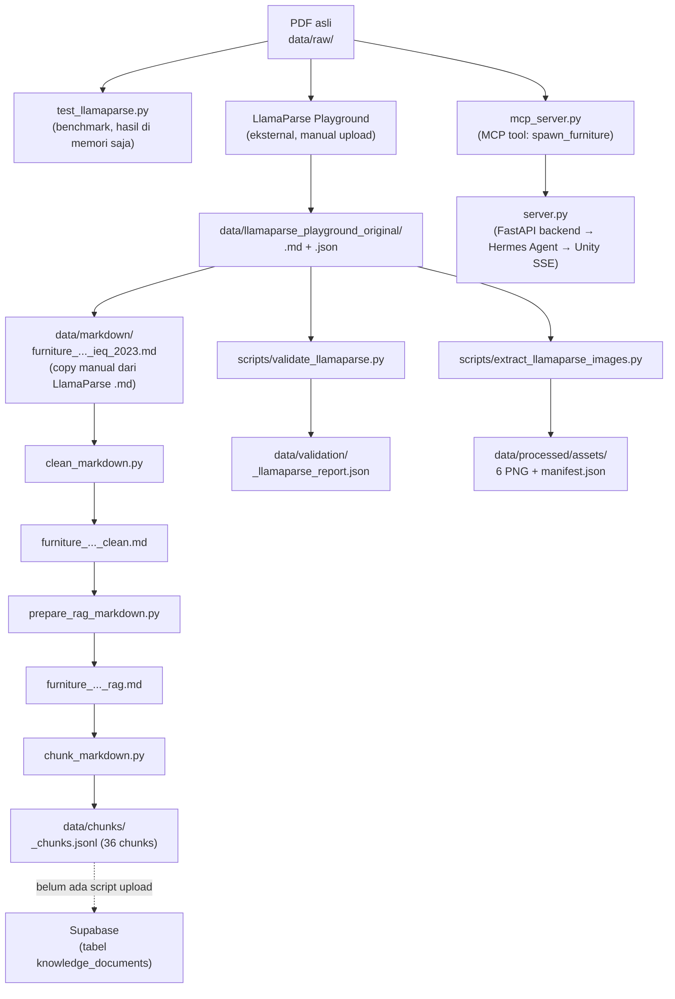

# Audit Report — RAG Pipeline `backend-dss`

**Tanggal:** 2026-11-20  
**Dokumen sumber:** `furniture_arrangement_ieq_2023.pdf` (22 halaman)  
**Status:** AUDIT SAJA — belum ada file yang diubah.

---

## 1. Alur Pipeline Saat Ini

### Peran masing-masing script

| Script | Fungsi |
|---|---|
| `test_llamaparse.py` | Benchmark upload + parse via LlamaParse SDK; hasil **hanya di memori**, tidak menyimpan file. |
| `clean_markdown.py` | Membaca `_ieq_2023.md` → ganti gambar base64 dengan placeholder `[Gambar dikecualikan…]`, ganti `<!-- formula-not-decoded -->` dengan placeholder `[Rumus tidak berhasil…]`, rapikan baris kosong → output `_clean.md`. |
| `prepare_rag_markdown.py` | Membaca `_clean.md` → hapus info kontak/afiliasi penulis, hapus email, perbaiki sitasi `Colenberg et al.`, **hapus placeholder gambar**, rapikan spasi → output `_rag.md`. |
| `chunk_markdown.py` | Membaca `_rag.md` → split per heading → paragraph grouping → char-based chunking (maks 2.200 karakter, overlap 250) → output `_chunks.jsonl` (36 chunks). Mengecualikan section References, Declarations, Front matter. |
| `scripts/validate_llamaparse.py` | Validasi JSON LlamaParse: cek halaman, tabel kosong, gambar tanpa caption, math delimiter, merge placeholder. |
| `scripts/extract_llamaparse_images.py` | Crop gambar dari PDF berdasar bbox di JSON LlamaParse → PNG + `manifest.json`. |
| `test_supabase.py` | Test koneksi ke Supabase dan query tabel `knowledge_documents`. |
| `mcp_server.py` | MCP tool `spawn_furniture` — kirim instruksi penempatan furnitur ke backend FastAPI. |
| `server.py` | FastAPI backend: endpoint `/api/chat` (forward ke Hermes Agent), `/api/mcp/spawn_furniture` (antrean SSE), `/api/stream` (SSE ke Unity client). |

---

## 2. Analisis Masalah 1–4

### Masalah 1 — Gambar/figure tidak terbaca sebagai teks (tidak bisa dicari RAG)

| Aspek | Temuan |
|---|---|
| **Sudah ditangani?** | Sebagian. `clean_markdown.py` mengganti 44 gambar base64 dengan placeholder. `prepare_rag_markdown.py` lalu **menghapus** placeholder tersebut seluruhnya. |
| **Masih bermasalah?** | **Ya, kritis.** Semua deskripsi gambar hilang total dari `_rag.md` dan chunks. RAG tidak bisa menemukan informasi yang hanya ada di gambar. |
| **Detail gambar yang hilang:** | |
| Fig. 1 (hal. 8) | Denah Office #1 + matriks illuminance — tabel illuminance terpecah jadi 63 baris angka terpisah (baris 225–381 `_rag.md`) |
| Fig. 2 (hal. 9) | Denah Office #2 + illuminance — sama, terpecah jadi angka-angka terpencar |
| Fig. 3 (hal. 10) | Orientasi meja — hilang total |
| Fig. 4–7 (hal. 11-12) | Layout pattern Office #1 & #2 — hanya caption di `_rag.md` tanpa deskripsi konten |
| Fig. 8–13 (hal. 11-13) | Grafik comfort index — hanya caption tanpa data |
| Fig. 14–19 (hal. 15-17) | Grafik perbandingan algoritma — hanya caption tanpa data |
| **Aset yang sudah diekstrak** | `extract_llamaparse_images.py` berhasil crop 6 gambar (page 11-12 saja) ke `data/processed/assets/`. Semua tanpa caption (`"unassigned"`). Halaman lain tidak di-crop. |
| **Dampak RAG** | Jika user bertanya "bagaimana denah Office #1?" atau "berapa lux di pojok kanan atas?", RAG tidak bisa menjawab. |

### Masalah 2 — Tabel tergabung dengan tabel sebelumnya

| Aspek | Temuan |
|---|---|
| **Sudah ditangani?** | `validate_llamaparse.py` **mendeteksi** masalah ini: `multi_table_page` (halaman 10, 12, 14, 15, 18), `EMPTY_MERGED_PLACEHOLDER` (halaman 14, 15, 16, 19), dan `header_value_type_mismatch` (halaman 10, 11, 12). |
| **Masih bermasalah?** | **Ya.** Deteksi ada, tapi belum ada koreksi otomatis. |
| **Lokasi spesifik di markdown:** | |
| `_rag.md` baris 225–381 | Matriks illuminance Office #2 (Fig. 2) terpecah menjadi 63 baris masing-masing berisi satu angka saja — data tabel dirusak oleh parser. Angka-angka ini masuk ke chunk 23 dan chunk 24 secara acak. |
| Tabel 1 (baris 369–374) | ✅ OK — terformat dengan benar sebagai markdown table. |
| Tabel 2 (baris 382–389) | ✅ OK — terformat. |
| Tabel 3 (baris 397–404) | ✅ OK — terformat. |
| Tabel 4 (baris 414–421) | ✅ OK — terformat. |
| Tabel 5 (baris 425–432) | ✅ OK — terformat. |
| **Sumber asli LlamaParse** | Markdown LlamaParse playground (`data/llamaparse_playground_original/furniture_arrangement_ieq_2023.md`) memiliki tabel illuminance dalam format `<table>` HTML yang benar, tapi pipeline Docling (`data/markdown/`) menghasilkan angka terpencar tanpa struktur tabel. |

### Masalah 3 — Rumus LaTeX error saat dirender

| Aspek | Temuan |
|---|---|
| **Sudah ditangani?** | `clean_markdown.py` mengganti 24 marker `<!-- formula-not-decoded -->` menjadi placeholder `[Rumus tidak berhasil diekstrak…]`. |
| **Masih bermasalah?** | **Ya, kritis.** Semua 24 rumus tetap hilang — hanya placeholder, bukan rumus asli. |
| **Perbandingan sumber:** | LlamaParse playground `.md` **memiliki semua 24 rumus dalam LaTeX yang benar** (Eq. 1–23 + Eq. 24). Contoh dari LlamaParse: `$$Q(s, a) \leftarrow (1 - \alpha)Q(s, a) + \alpha \left[ R + \gamma \cdot \max_{a'} Q(s', a') \right]$$` |
| **Lokasi rumus yang hilang di `_rag.md`:** | |
| Baris 55 | Eq. 1 — Bellman Equation (Section 3.2) |
| Baris 61 | Eq. 2 — Q̂-vector definition |
| Baris 65 | Eq. 3 — Weighted sum SQ(s,a) |
| Baris 69 | Eq. 4 — Multi-objective Q-update rule |
| Baris 77 | Eq. 5 — MOMDP tuple definition |
| Baris 87 | Eq. 6 — Reward vector |
| Baris 97 | Eq. 7 — L_Receiver (sound pressure) |
| Baris 101 | Eq. 8 — Room constant Ac_R |
| Baris 105 | Eq. 9 — Mean absorption coefficient |
| Baris 111 | Eq. 10 — Total receiver sound level |
| Baris 117 | Eq. 11 — Mean radiant temperature |
| Baris 125 | Eq. 12 — Reward function R |
| Baris 131 | Eq. 13 — R_dist-users |
| Baris 135 | Eq. 14 — D_ij distance |
| Baris 139 | Eq. 15 — R_user_i |
| Baris 145 | Eq. 16 — R_IEQ |
| Baris 149 | Eq. 17 — TC_index |
| Baris 153 | Eq. 18 — PD_TC |
| Baris 159 | Eq. 19 — AC_index |
| Baris 163 | Eq. 20 — PD_Acc |
| Baris 169 | Eq. 21 — VC_index |
| Baris 173 | Eq. 22 — PD_L |
| Baris 179 | Eq. 23 — Normalization formula |
| Baris 464 | Eq. 24 — IEQ_Tot (Section 6) |
| **Dampak RAG** | Rumus-rumus ini adalah inti metode paper. RAG tidak bisa menjelaskan bagaimana reward dihitung, bagaimana comfort index dievaluasi, atau bagaimana Q-learning bekerja. |
| **Karakter Unicode rusak** | Selain placeholder, teks di sekitar rumus menggunakan raw unicode codepoint (contoh: `u1D6FC` sebagai ganti α, `u1D6FE` sebagai ganti γ, `u1D716` sebagai ganti ε). Ini terjadi di pipeline Docling, bukan LlamaParse. |

### Masalah 4 — Hierarki heading belum rapi

| Aspek | Temuan |
|---|---|
| **Sudah ditangani?** | `chunk_markdown.py` memfilter heading `#Test` palsu (baris 112–119) tapi tidak memperbaiki hierarki. |
| **Masih bermasalah?** | **Ya.** |
| **Detail:** | |
| Semua heading | Semua heading hanya level `##` (H2) — tidak ada hierarki `#` → `##` → `###`. Bandingkan: LlamaParse playground menggunakan `##` (H2) untuk judul bab, `###` (H3) untuk sub-bab, sesuai PDF asli. |
| `\x07` (BEL char) | Karakter kontrol `\x07` (U+0007) tersisip di banyak heading: `## 2 \x07Related works`, `## 3.1 \x07Indoor comfort conditions`, dll. Ini artefak Docling. Total 16 heading terdampak. |
| `#Test` palsu (baris 485, 491) | Artefak ekstraksi dari caption figur "Test" di halaman grafik perbandingan. `chunk_markdown.py` sudah menangani ini. |
| `1 3` terisolasi (baris 157/179) | Artefak nomor halaman jurnal ("1 3" = halaman 13) yang masuk ke body text. Tidak ada script yang membersihkan ini. |

---

## 3. Kualitas Chunks

### Statistik

| Metrik | Nilai |
|---|---|
| Total chunks | 36 |
| Ukuran minimum | 527 karakter |
| Ukuran maksimum | 2.488 karakter |
| Rata-rata | 1.838 karakter |
| Chunks berisi placeholder rumus | 12 (chunk 9–17, 30) |
| Chunks berisi tabel markdown | 3 (chunk 25, 26, 28) |

### Masalah chunks

| Masalah | Chunk | Detail |
|---|---|---|
| **Angka illuminance terpecah** | Chunk 23–24 | 63+ angka lux tanpa konteks (mis: "400", "580", "550"…) masuk sebagai teks biasa, bukan tabel. Chunk 23 memiliki 2.488 karakter di mana sebagian besar adalah angka terpencar. Ini sampah bagi embedding model. |
| **Rumus hanya placeholder** | Chunk 9–17, 30 | Teks menjelaskan "where R is the reward…" tapi rumusnya hilang. Retrieval akan menemukan konteks tapi tidak bisa memberikan rumus. |
| **Gambar hilang total** | Semua chunk | Tidak ada deskripsi gambar atau referensi ke aset gambar yang sudah di-crop. Caption figur (Fig. 1, Fig. 2, dll.) ada tapi tanpa isi. |
| **Tabel terpotong oleh chunk boundary?** | **Tidak** | Tabel 1–5 dalam format markdown pipe table dan semuanya berada utuh dalam chunk masing-masing (chunk 25, 26, 28). ✅ |
| **Overlap antar section** | **Benar** | Overlap hanya terjadi dalam section yang sama, sesuai logika `chunk_markdown.py`. ✅ |
| **page_number selalu null** | Semua chunk | `page_number: null` — tidak ada mapping halaman PDF ke chunk. |
| **Section name mengandung `\x07`** | Chunk 4–35 | Karakter BEL tersisa di field `section` dan `metadata.section`. |

---

## 4. MCP Server & Server.py

### `mcp_server.py`

| Aspek | Detail |
|---|---|
| Framework | `FastMCP` (SDK MCP resmi) |
| Transport | `stdio` |
| Tool tersedia | **1 tool: `spawn_furniture`** — kirim instruksi penempatan furnitur ke backend (`POST /api/mcp/spawn_furniture`). |
| Auth | Menggunakan `API_SERVER_KEY` dari `~/.hermes/.env`. |
| **Koneksi ke Supabase?** | ❌ **Tidak.** Tidak ada tool untuk query knowledge base, semantic search, atau retrieval dari Supabase. |
| **Tool RAG?** | ❌ **Tidak ada.** MCP server hanya untuk DSS furniture placement, bukan untuk RAG. |

### `server.py`

| Aspek | Detail |
|---|---|
| Framework | FastAPI + SSE (`sse_starlette`) |
| Endpoints | `GET /` (health), `GET /health`, `POST /api/mcp/spawn_furniture` (antrean SSE), `POST /api/chat` (forward ke Hermes Agent), `GET /api/stream` (SSE ke Unity). |
| Koneksi LLM | Forward ke Hermes Agent di `http://127.0.0.1:8642/v1/chat/completions` dengan model `hermes-agent`. System prompt menyuruh agent memanggil tool `spawn_furniture`. |
| **Koneksi ke Supabase?** | ❌ **Tidak.** Server tidak melakukan retrieval dari Supabase. |
| **RAG integration?** | ❌ **Tidak ada.** Chat endpoint hanya mengirim prompt + spatial context ke Hermes, tanpa retrieval context dari knowledge base. |

### `test_supabase.py`

| Aspek | Detail |
|---|---|
| Koneksi | Berhasil connect ke Supabase, query tabel `knowledge_documents`. |
| **Upload chunks?** | ❌ **Tidak ada script** yang mengupload chunks ke Supabase. Pipeline berhenti di file `.jsonl`. |

---

## 5. Gap Summary — Apa yang Perlu Diperbaiki

> [!CAUTION]
> Pipeline saat ini menghasilkan chunks yang kehilangan **rumus, gambar, dan struktur tabel penting**.
> RAG tidak akan bisa menjawab pertanyaan tentang metode inti paper.

### Prioritas Tinggi

| # | Masalah | Dampak |
|---|---|---|
| G1 | **24 rumus LaTeX hilang** — tersedia di LlamaParse playground `.md` tapi tidak dipakai | RAG tidak bisa menjelaskan metode |
| G2 | **Semua gambar/figure hilang dari chunks** — 6 gambar sudah di-crop tapi tidak ada deskripsi teks untuk RAG | RAG tidak bisa menemukan informasi visual |
| G3 | **Matriks illuminance terpecah** — tabel Fig. 1 & Fig. 2 menjadi 63 baris angka acak di chunks | Data penting Office #1 & #2 rusak |
| G4 | **Belum ada upload ke Supabase** — pipeline berhenti di JSONL | RAG belum bisa berjalan |
| G5 | **MCP server tidak punya tool RAG** — hanya `spawn_furniture` | Agentic AI tidak bisa query knowledge base |

### Prioritas Sedang

| # | Masalah | Dampak |
|---|---|---|
| G6 | **Karakter Unicode rusak** (`u1D6FC` → α, `u1D6FE` → γ, `u1D716` → ε) | Teks sulit dibaca |
| G7 | **Karakter BEL (`\x07`) di heading dan section name** | Polusi metadata chunk |
| G8 | **Hierarki heading flat** (semua `##`) | Chunking tidak bisa manfaatkan hierarki |
| G9 | **`page_number` selalu null** | Tidak bisa cite halaman PDF |
| G10 | **`#Test` artefak** di baris 485, 491 `_rag.md` | Noise di teks |

### Prioritas Rendah

| # | Masalah | Dampak |
|---|---|---|
| G11 | **`1 3` (nomor halaman jurnal)** masuk ke body text (baris 157) | Minor noise |
| G12 | **Hanya 6 dari ~19 gambar yang di-crop** | Aset gambar tidak lengkap |
| G13 | **Semua caption gambar `"unassigned"`** di manifest | Caption belum diassign ke gambar |

---

## 6. Rekomendasi Urutan Perbaikan (Belum Dieksekusi)

1. **Gunakan LlamaParse playground `.md` sebagai sumber utama** — file ini memiliki rumus LaTeX lengkap, tabel HTML yang benar, dan heading yang lebih terstruktur.
2. **Buat script baru** untuk: membersihkan artifact LlamaParse (logo, page header/footer, `icon:`, ``) tanpa menghancurkan rumus/tabel.
3. **Tambahkan deskripsi teks untuk setiap gambar** — bisa dari caption di markdown + alt-text manual dari visual review.
4. **Perbaiki chunking** agar: tabel dan deskripsi gambar tidak terpotong, rumus tetap bersama konteksnya, `page_number` di-mapping.
5. **Buat script upload ke Supabase** — embed chunks dan push ke `knowledge_documents`.
6. **Tambah MCP tool RAG** di `mcp_server.py` — tool `search_knowledge` yang query Supabase semantic search.

---

> **AUDIT SELESAI. Menunggu persetujuan sebelum melanjutkan ke perbaikan.**
