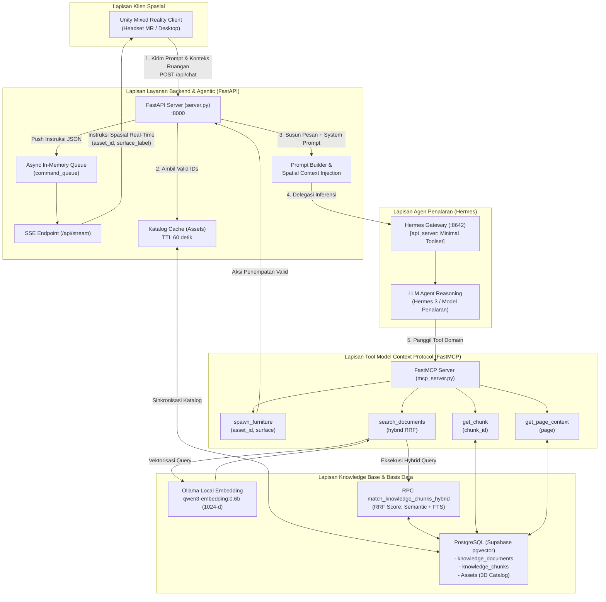

# Laporan Progres Pengembangan Sistem Decision Support System (DSS) Berbasis Agentic RAG untuk Mixed Reality

**Topik:** Decision Support System Penataan Furnitur Berbasis Reinforcement Learning & Indoor Environmental Quality (IEQ) dalam Lingkungan Mixed Reality  
**Kasus Studi Dokumen:** *“A multi-objective reinforcement learning approach for furniture arrangement with optimal IEQ in multi-occupant offices”* (Ribino & Bonomolo, 2023)  
**Status Tanggal:** 24 November 2026  
**Dokumen Referensi Proyek:** `docs/automation_audit.md`, `docs/automation_design.md`, `docs/verification_report.md`, `eval/results.md`

---

## 1. Ringkasan Eksekutif dan Status vs Proposal

Sistem ini dikembangkan sebagai backend Decision Support System (DSS) cerdas yang menggabungkan kecerdasan agen (*Agentic AI*), *Retrieval-Augmented Generation* (RAG) dokumen ilmiah berkepadatan tinggi, dan antarmuka spasial *Mixed Reality* (MR). Tujuan utamanya adalah membantu perancang tata letak ruangan mengoptimalkan penataan furnitur kantor multi-penghuni berdasarkan simulasi *Indoor Environmental Quality* (IEQ) yang mencakup kenyamanan termal (*Thermal Comfort*), kenyamanan visual (*Visual Comfort*), kenyamanan akustik (*Acoustic Comfort*), serta jarak fisik antar-pengguna.

Berikut adalah rekapitulasi status implementasi komponen sistem dibandingkan target awal:

| No | Komponen Sistem | Target Awal / Rencana | Status Realisasi Saat Ini | Keterangan & Deviasi |
|:--:|:---|:---|:---:|:---|
| 1 | **Ekstraksi Dokumen Ilmiah Multimodal** | Mengekstrak teks, tabel multi-baris, rumus matematis LaTeX, dan grafik visual dari paper acuan ilmiah. | **Selesai (100%)** | Berhasil memproses 22 halaman paper Springer (Ribino & Bonomolo, 2023). 19 gambar akademik dan 8 rumus kompleks divalidasi visual. |
| 2 | **Knowledge Base & Hybrid Retrieval** | Menyimpan chunk ilmiah ke PostgreSQL pgvector dengan pencarian hibrida (semantik + leksikal) dan ranking terpadu. | **Selesai (100%)** | 40 chunk tersimpan di Supabase pgvector. Menggunakan model embedding lokal `qwen3-embedding:0.6b` (1024-dimensi) dan RPC `match_knowledge_chunks_hybrid` berbasis Reciprocal Rank Fusion (RRF, $k=60$). |
| 3 | **Antarmuka FastMCP Toolset** | Menyediakan antarmuka Model Context Protocol (MCP) terstandarisasi untuk menghubungkan LLM dengan database dan backend. | **Selesai (100%)** | 4 tools MCP aktif: `spawn_furniture`, `search_documents`, `get_chunk`, `get_page_context`. Gateway diisolasi dengan konfigurasi `api_server: []` demi keamanan dan eliminasi timeout. |
| 4 | **Agentic Reasoning & Grounding** | LLM Agent mampu menalar kebutuhan perancangan, mencari literatur secara mandiri, dan menghindari halusinasi ilmiah. | **Selesai (100%)** | Hermes Agent diatur dengan prompt grounding ketat: larangan klaim kausalitas tanpa dasar paper, kewajiban kata "sekitar" untuk estimasi grafik, serta penolakan otomatis pertanyaan luar-domain. |
| 5 | **Streaming Instruksi ke Klien Spasial** | Menyalurkan instruksi penataan furnitur ke klien Mixed Reality secara asinkron dan real-time. | **Selesai Sebagian** | Endpoint Server-Sent Events (SSE) `/api/stream` dan antrean asinkron aktif. Aksi `spawn_furniture` berhasil terkirim ke antrean. |
| 6 | **Penentuan Koordinat Posisi 3D di Backend** | Menghitung koordinat penempatan 3D ($x, y, z$) furnitur di backend DSS sebelum dikirim ke Unity. | **Belum Ada** | Backend saat ini hanya memvalidasi `asset_id` katalog dan `surface_label` (`FLOOR`, `WALL`, `TABLE`). Kalkulasi posisi transformasi koordinat 3D masih ditangani di sisi klien Unity. |
| 7 | **Analisis Visual Real-Time Frame MR** | Menganalisis kondisi aktual ruangan fisik dari tangkapan kamera headset MR via Vision-Language Model (VLM). | **Belum Ada** | Ruangan saat ini masih dimodelkan melalui data konteks spasial statis berbasis JSON (`spatial_data` di `server.py`). Integrasi frame video kamera MR belum diimplementasikan. |
| 8 | **Otomatisasi Pipeline Multi-Jurnal** | Pipeline generik satu-perintah untuk menelan berbagai dokumen ilmiah baru secara otomatis tanpa *hardcoded rules*. | **Tahap Desain (Siap Uji)** | Dokumen arsitektur selesai (`docs/automation_design.md`). Desain Versi 1 (estimasi 2–4 hari kerja) dijadwalkan untuk dieksekusi setelah sidang skripsi. |

> [!NOTE] Informasi Terverifikasi vs Perlu Pengecekan
> Target proposal awal yang dirangkum di atas disarikan dari git log awal (`bd6064d` dan `77bfbb7`), arsitektur server, dan laporan verifikasi. Detail kuantitatif target proposal awal seperti *target frame rate minimum pada headset MR* atau *jumlah target dokumen kumulatif pada naskah proposal skripsi* berstatus `[PERLU DICEK: target kuantitatif pada dokumen proposal tertulis]`.

---

## 2. Arsitektur Sistem Terbaru

Arsitektur sistem dibangun di atas tiga lapisan utama:
1. **Lapisan Visualisasi & Klien Spasial (Mixed Reality / Unity):** Berfungsi sebagai antarmuka pengguna untuk melihat lingkungan kantor virtual/nyata. Klien mengirim prompt perancangan atau pertanyaan ilmiah ke endpoint REST `/api/chat` dan menerima aliran instruksi penempatan objek 3D melalui koneksi persisten Server-Sent Events (SSE) `/api/stream`.
2. **Lapisan Layanan Backend & Agentic Orchestration:**
   - **FastAPI Core (`server.py`):** Mengelola siklus hidup permintaan, memuat katalog furnitur dari Supabase, menginjeksi konteks spasial ruangan, dan menyusun *system prompt* untuk agen.
   - **Hermes Gateway & LLM Agent:** Berperan sebagai otak pengambil keputusan. Platform gateway dikunci secara ketat dengan toolset minimal (`platform_toolsets.api_server: []`), memastikan agen hanya dapat mengakses tool domain internal.
   - **FastMCP Server (`mcp_server.py`):** Server berbasis FastMCP yang mengekspos 4 tools operasional melalui antarmuka stdio terisolasi.
3. **Lapisan Knowledge Base & Retrieval (Supabase PostgreSQL):**
   - Menggunakan ekstensi `pgvector` untuk pencarian vektor dan `pg_trgm` / `tsvector` untuk pencarian leksikal.
   - Didukung oleh model embedding lokal `qwen3-embedding:0.6b` yang berjalan pada instance Ollama lokal tanpa dependensi koneksi internet publik.

### Diagram Alur Arsitektur Sistem



---

## 3. Pipeline Dokumen: Permasalahan Parsing dan Solusi

Pada fase awal pemrosesan dokumen ilmiah (*Phase 1 & 2*), ditemukan berbagai anomali struktural akibat kompleksitas tata letak dua-kolom penerbit Springer dan adanya tabel/gambar *floating*. Seluruh anomali tersebut telah diidentifikasi dan ditangani melalui perbaikan bertingkat:

| No | Komponen Dokumen | Masalah Ekstraksi LlamaParse (Sebelum) | Solusi & Teknik Rekonstruksi (Sesudah) | Status Verifikasi |
|:--:|:---|:---|:---|:---:|
| 1 | **Tabel Multi-Run Uji Coba (Fig. 8–13)** | LlamaParse menghasilkan 3 tabel HTML mentah raksasa (indeks tabel 5, 6, 7) berisi data mentah 20 pengujian individual tanpa nilai statistik ringkasan, menimbulkan redundansi ekstrem. | Tabel-tabel mentah tersebut dieliminasi dari teks RAG melalui `process_all_tables()`, digantikan oleh deskripsi terverifikasi dari grafik batang hasil visual reading. | **Terverifikasi** (Tabel bising terhapus) |
| 2 | **Label Caption Tabel Hilang** | Caption untuk *Table 4*, *Table 5*, dan *Table 11* terlepas atau hilang dari struktur tabel HTML akibat pemotongan batas kolom. | Rekonstruksi caption generik berbasis deteksi pola `Table\s+\d+.*` dalam radius baris teks terdekat dan pengikatan langsung ke tabel Markdown pipe. | **Terverifikasi** (Caption terikat utuh) |
| 3 | **Matriks Iluminansi Cahaya (Fig. 1 & 2)** | Grid pencahayaan 7 baris × 9 kolom di dalam denah ruangan diekstrak rusak oleh OCR sebagai angka acak yang terfragmentasi. | Dilakukan rekonstruksi terstruktur matriks grid 2D numerik (`ILLUMINANCE_TABLE_1` dan `ILLUMINANCE_TABLE_2`) sesuai nilai pencahayaan lux tertera di PDF asli. | **Terverifikasi** (100% cocok dengan PDF) |
| 4 | **Fragmentasi Teks Section 6** | Paragraf pembuka *Section 6 (Algorithm comparison)* terpotong menjadi 3 fragmen terpisah di halaman 11, 12, dan 13 di sela-sela gambar Fig. 8–13. | Penerapan fungsi restrukturisasi `fix_section_6_placement()` yang mendeteksi heading dan menyatukan kembali 3 fragmen kalimat menggantung menjadi narasi utuh. | **Terverifikasi** (Paragraf tersambung) |
| 5 | **Relokasi Gambar Fig. 19 & Section 7** | LlamaParse salah meletakkan Fig. 19 dan tabel komparasi algoritma ke dalam *Section 7 Conclusions* karena posisinya yang berada di bagian bawah halaman 20. | Implementasi `fix_section_6_2_and_7_placement()` yang memotong blok Fig. 19 dari Section 7 dan mengembalikannya ke posisi rujukan aslinya di akhir Section 6.2. | **Terverifikasi** (Fig. 19 berada di Sec 6.2) |
| 6 | **Tipe Visual Grafik (Figures 8–19)** | Deskripsi teks bawaan secara keliru menyebut Fig. 8–13 sebagai "grafik garis" dan Fig. 19 mengutip angka narasi 105 s alih-alih data aktual grafik 4.40 s – 20.52 s. | Seluruh 19 gambar diaudit visual mandiri: tipe dikoreksi menjadi *grouped bar chart*, legenda warna dipetakan, garis ambang batas (*threshold*) ditambahkan, dan angka disalin presisi. | **Terverifikasi** (19/19 Gambar sesuai visual asli) |
| 7 | **Integritas Simbol Rumus LaTeX** | Resiko pemotongan sintaksis LaTeX formula matematika panjang seperti Persamaan Bellman dan pembobotan vektor reward. | Validasi regex simbol LaTeX (`validate_latex.py`). 8 rumus kompleks diverifikasi simbol demi simbol terhadap PDF asli; semua blok formula dipastikan memiliki pasangan tanda `$$`. | **Terverifikasi** (0 rumus terpotong) |

---

## 4. Arsitektur Knowledge Base

### 4.1. Strategi Chunking Dokumen
Data naskah ilmiah diproses melalui chunking hierarkis berbasis struktur section (*AST-aware*) dengan batasan karakter fleksibel untuk menjaga keutuhan informasi:
- **Jumlah Chunk:** 40 unit chunk terstruktur (`chunk_000` s.d. `chunk_039`).
- **Distribusi Ukuran:** Median 2.059 karakter (rentang 773 s.d. 2.786 karakter). Tidak ada chunk yang terlalu pendek (<300 karakter).
- **Integritas Semantik:** Chunk berukuran >2.500 karakter dipertahankan secara sengaja agar tabel Markdown, blok rumus LaTeX, dan deskripsi gambar tidak terpotong di tengah-tengah.
- **Overlap Konteks:** Menggunakan mekanisme `overlap_tail()` sepanjang ~250 karakter pada perbatasan paragraf narasi untuk menjamin kontinuitas semantik antarchunk.
- **Metadata per Chunk:** Menyimpan `page_number`, `page_numbers` (rentang multi-halaman jika chunk melintasi batas halaman fisik), `heading_path` (mis. `"5 > 5.1 Results and discussions"`), `content_type` (`narrative`, `table`, `formula`, `figure`), `image_path` (jika memuat gambar), serta boolean flags (`has_table`, `has_latex`, `has_figure_description`).

### 4.2. Model Embedding Lokal
- **Nama Model:** `qwen3-embedding:0.6b` dijalankan secara *on-premises* via instance Ollama lokal.
- **Dimensi Vektor:** 1.024 dimensi *dense vector float*.
- **Keunggulan:** Operasional sepenuhnya *offline*, tanpa biaya token eksternal, latensi generasi embedding stabil (<50 ms per kueri), dan memiliki pemahaman konteks teknis ilmiah multibahasa yang solid.

### 4.3. Skema Basis Data Supabase
Penyimpanan data mengandalkan dua tabel relasional utama pada PostgreSQL:
1. `knowledge_documents`: Menyimpan metadata level dokumen (`id`, `source`, `title`, `content_hash`, `metadata`, `total_chunks`, `created_at`, `updated_at`).
2. `knowledge_chunks`: Menyimpan data segmen dokumen (`id`, `document_id` [FK], `chunk_index`, `chunk_id`, `page_number`, `heading_path`, `content_type`, `image_path`, `content`, `content_hash`, `embedding` [vector(1024)], `metadata` [jsonb]).
3. **Indeks Performa:**
   - Indeks HNSW (`idx_knowledge_chunks_embedding`) dengan operator `vector_cosine_ops` ($m = 16, ef\_construction = 64$).
   - Indeks GIN Full-Text Search pada kolom teks `content`.
   - Indeks B-Tree pada kolom referensi `document_id`, `chunk_id`, dan `page_number`.

### 4.4. Mekanisme Hybrid Search dengan Reciprocal Rank Fusion (RRF)
Pencarian pengetahuan diimplementasikan melalui *Stored Procedure* PostgreSQL `match_knowledge_chunks_hybrid` (hasil migrasi `004_hybrid_or_query.sql`). Fungsi ini menggabungkan dua lintasan pencarian (*dual-path retrieval*):
1. **Lintasan Semantik:** Menghitung *cosine similarity* antara embedding kueri dan kolom `embedding`:
   $$\text{Semantic\_Score} = 1 - (\text{embedding} \Leftrightarrow \text{query\_vector})$$
2. **Lintasan Leksikal:** Menghalau keterbatasan semantik murni terhadap istilah teknis, akronim, atau angka spesifik menggunakan *Full-Text Search* (`tsquery`) dengan operator OR logis dan pembobotan *ts_rank*.
3. **Penyatuan Peringkat (Reciprocal Rank Fusion):**
   Kedua daftar peringkat digabungkan secara matematis tanpa memerlukan normalisasi skor absolut yang bias:
   $$RRF\_Score = \frac{1}{k + rank_{sem}} + \frac{1}{k + rank_{fts}} \quad (\text{dengan konstanta } k = 60)$$
Fungsi ini juga mendukung filter dinamis: `p_filter_content_type`, `p_filter_page_number`, `p_filter_has_latex`, `p_filter_has_table`, `p_filter_has_figure_description`, dan `p_filter_source`.

---

## 5. Lapisan Agentic AI: Integrasi Hermes & FastMCP

### 5.1. Antarmuka Tool FastMCP
Server FastMCP menyediakan 4 alat bantu (*tools*) yang didaftarkan ke runtime agen:
1. `spawn_furniture(asset_id: str, surface_label: str)`: Memvalidasi ketersediaan aset pada katalog 3D Supabase dan mengirim instruksi penempatan furnitur ke antrean streaming Unity SSE.
2. `search_documents(query: str, top_k: int = 5, content_type: str | None = None, page: int | None = None, source: str | None = None)`: Menjalankan *hybrid search* RRF ke basis data pengetahuan dengan filter opsional.
3. `get_chunk(chunk_id: str)`: Mengambil isi teks lengkap dan metadata spesifik dari satu ID chunk tertentu.
4. `get_page_context(page: int)`: Mengambil seluruh teks dan konteks yang berada pada satu nomor halaman fisik PDF tertentu.

### 5.2. Konfigurasi Keamanan Toolset Minimal Gateway (`api_server: []`)
Pada pengujian awal (Tahap 4), ditemukan kelemahan operasional kritis: saat pengguna mengajukan pertanyaan komparasi angka tabel, Hermes Agent secara otomatis memanggil tool bawaan sistem operasi (`execute_code` Python) untuk menghitung selisih angka. Hal ini memicu loop komputasi tak berujung hingga *timeout* 180 detik.

**Solusi Arsitektur (Tahap 4B):**  
Platform HTTP gateway (`api_server` pada port 8642) dikonfigurasi secara deklaratif dengan mematikan seluruh toolset bawaan non-MCP:
```yaml
platform_toolsets:
  api_server: []
```
Dengan konfigurasi ini, toolset seperti `code_execution`, `terminal`, `file`, `browser`, `cronjob`, dan `web_search` dinonaktifkan sepenuhnya pada kanal API server backend. Hermes Agent dijamin hanya dapat melihat dan memanggil 4 tool domain FastMCP. Hasilnya, latensi inferensi kembali stabil di bawah 30 detik tanpa risiko eksekusi kode arbitrer.

### 5.3. Rekayasa System Prompt & Aturan Anti-Halusinasi (Tahap 4C)
Untuk mencegah model LLM menarik kesimpulan yang melampaui data literatur, *system prompt* pada `server.py` diperkuat dengan batasan faktualitas ketat:
- **Netralitas Kausalitas (*No Unstated Causality*):** Model dilarang keras menyimpulkan alasan atau hubungan sebab-akibat yang tidak dinyatakan secara eksplisit oleh penulis paper (misalnya, paper hanya menyebut total reward Office #2 lebih tinggi dari Office #1 pada Table 1 tanpa membuktikan alasannya; agen diwajibkan menyatakan keterbatasan ini secara jujur).
- **Larangan Fabrikasi Entitas:** Dilarang menyebut subjek (mis. *"User #1"*) atau mekanisme fisik yang tidak tercantum dalam teks chunk hasil *retrieval*.
- **Kualifikator Estimasi Visual:** Angka yang bersumber dari pembacaan visual grafik batang (Fig. 8 s.d. 13) wajib menggunakan kata kualifikator *"sekitar"* dan dilarang mengarang desimal semu.
- **Penolakan Mandiri Luar-Domain:** Pertanyaan di luar ranah perancangan arsitektur dan IEQ (mis. resep kuliner) ditolak secara langsung dengan format standar tanpa memanggil tool penempatan furnitur.
- **Validasi Katalog Tertutup:** Penempatan furnitur wajib memilih `asset_id` yang terdaftar pada katalog Supabase (`valid_ids`), mencegah terciptanya ID fiktif seperti `"wooden_table_01"`.

---

## 6. Hasil Evaluasi Sistem

Evaluasi sistem dilakukan secara formal menggunakan dataset benchmark berisi 26 pertanyaan terstruktur (`eval/questions.json`) yang mencakup berbagai tipe informasi ilmiah: teks narasi (7), tabel data (6), grafik visual (5), formula matematis (3), pertanyaan lintas bagian (3), serta pertanyaan di luar domain dokumen (2).

### 6.1. Metrik Kinerja Retrieval Baseline (Mode 1: 24 Pertanyaan In-Domain)
Evaluasi Mode 1 mengukur efektivitas *hybrid search* Supabase dalam menemukan chunk acuan (*ground truth*) yang memuat jawaban yang tepat di dalam posisi Top-5:

| Metrik Evaluasi | Nilai Kinerja | Keterangan & Analisis Hasil |
|:---|:---:|:---|
| **Jumlah Sampel In-Domain ($N$)** | **24 Pertanyaan** | Mencakup seluruh kategori pertanyaan di dalam cakupan dokumen ilmiah (Q01–Q16, Q19–Q26). |
| **Hit@1** | **58.33% (14 / 24)** | Pada lebih dari separuh kasus uji, chunk target utama langsung berada di peringkat teratas (#1). |
| **Hit@3** | **83.33% (20 / 24)** | Pada 83.3% kasus, chunk target ditemukan di dalam 3 hasil teratas. |
| **Hit@5** | **95.83% (23 / 24)** | Sebanyak 23 dari 24 pertanyaan berhasil menemukan chunk target dalam Top-5. |
| **Mean MRR (Mean Reciprocal Rank)** | **0.7236** | Rata-rata bobot posisi kebalikan peringkat membuktikan chunk target terkonsentrasi di peringkat atas. |
| **Mean Recall@5** | **90.97%** | Rata-rata persentase chunk acuan yang berhasil terjaring dari total chunk yang diharapkan. |
| **Miss@5** | **1 Pertanyaan (Q02)** | Hanya Q02 yang tidak masuk Top-5 (*rank = None*) akibat formulasi kueri leksikal yang terlalu panjang. |

### 6.2. Keterbatasan Metodologis Evaluasi
Dalam menafsirkan hasil evaluasi di atas, terdapat beberapa keterbatasan ilmiah yang perlu dicatat secara transparan:
1. **Ukuran Sampel Terbatas:** Dataset benchmark berukuran $N = 24$ pertanyaan in-domain. Meskipun mencakup representasi seimbang antar-tipe konten, ukuran sampel ini belum mencerminkan variasi distribusi kueri skala besar.
2. **Penyusunan Pertanyaan Internal:** Pertanyaan dan jawaban acuan disusun oleh tim pengembang sistem berdasarkan analisis naskah fisik PDF, sehingga berpotensi memiliki bias kedekatan leksikal terhadap struktur dokumen (*developer-authored evaluation bias*).
3. **Mekanisme Deteksi Luar-Domain:** Pengujian terhadap pertanyaan di luar domain dokumen (Q17 resep masakan & Q18 konsumsi listrik kWh) menunjukkan bahwa penolakan dilakukan pada **level penalaran kognitif LLM Agent (Hermes)**, bukan pada level ambang batas matematis tool *retrieval*. Pada level database, kueri luar domain yang memuat kata umum bahasa Inggris (seperti *'steps'*) tetap mengembalikan skor kecocokan teks parsial.

### 6.3. Hasil Evaluasi Penalaran Agen End-to-End (Mode 2: Tahap 4C)
Tabel berikut menunjukkan performa inferensi agen pada pertanyaan uji representatif pasca-penerapan perbaikan prompt Tahap 4C:

| ID | Pertanyaan User | Kueri Reformulasi Agen | Sitasi Dokumen | Waktu Respons | Analisis Kualitas Jawaban |
|:---|:---|:---|:---|:---:|:---|
| **Q19** | *Karakteristik fisik Office #1 vs #2 dan kaitannya dengan total reward Table 1?* | `'Office #2 Office #1 layout performance consistency results IEQ'` | `[Hal. 9–13, Sec 5.1]` | 15.69 s | Menyebut dimensi fisik kedua kantor secara lengkap dan secara eksplisit menyatakan bahwa paper tidak menjelaskan alasan kausal perbedaan reward. |
| **Q22** | *Stabilitas optimasi MORL vs PPO, DQN, dan A2C?* | `'MORL PPO DQN A2C stability robustness comparative optimization'` | `[Hal. 12–13, Sec 6; Hal. 17–19, Sec 6.1]` | 14.07 s | Melaporkan keunggulan standar deviasi MORL (paling stabil) pada 5 pengujian dan menguraikan konvergensi langkah pembelajaran. |
| **Q23** | *Standar bising kantor dan apakah ruangan uji memenuhi standar?* | `'office acoustic noise sound level recommended standard test office room dB'` | `[Hal. 11–13, Sec 5.1]` | 16.37 s | Menyebutkan standar 45 dB, serta menegaskan bahwa **kedua kantor tidak memenuhi standar** (~50 dB di Office #1 dan ~52 dB di Office #2). |
| **Q24** | *Pengaruh kursi dekat jendela terhadap kenyamanan termal di Office #2 Layout 2?* | `'Office #2 Layout Pattern #2 occupant chair close to window thermal comfort'` | `[Hal. 10–12, Sec 5.1]` | 10.54 s | Menjelaskan penurunan indeks termal menjadi 93.0 akibat radiasi permukaan jendela tanpa mengarang klaim subjek tertentu yang sengaja didekatkan. |
| **Q25** | *Perbandingan waktu eksekusi MORL vs NSGA-II?* | `'MORL NSGA-II execution time different test scenarios'` | `[Hal. 20–21, Sec 6.2]` | 10.92 s | Menyalin presisi 5 pasang angka waktu eksekusi Test 1 s.d. Test 5 (Test 1: 4.00s vs 4.40s; Test 5: 19.39s vs 20.52s). |
| **Q26** | *Pembobotan prioritas kenyamanan IEQ vs jarak spasial pada reward?* | `'IEQ satisfaction spatial distance constraints reward function weighting'` | `[Hal. 9–10, Sec 5]` | 11.97 s | Mengutip eksak vektor bobot $W = (0.4, 0.4, 0.2)$ dan bobot internal kenyamanan termal, akustik, visual masing-masing $p = 0.33$. |
| **Q17** | *Resep memasak rendang daging sapi Minangkabau? (Out-of-Domain)* | *(Tidak memanggil tool)* | *(Tanpa sitasi)* | 0.81 s | Ditolak seketika (*zero-shot rejection*): *"Pertanyaan ini di luar cakupan sistem dan tidak ada di dokumen."* |

---

## 7. Temuan Penting dan Pelajaran (*Lessons Learned*)

1. **Pemisahan Tegas antara Konteks Aplikasi dan Pipeline Data:**  
   Logika operasional aplikasi Mixed Reality (katalog 3D, antrean SSE, dan *spatial context*) harus dipisahkan secara struktural dari pipeline penyiapan dokumen ilmiah. Mencampur keduanya dalam satu skrip menimbulkan dependensi sirkular yang menyulitkan pengujian regresi.
2. **Kecenderungan Halusinasi Kausalitas pada LLM:**  
   Model LLM memiliki kecenderungan kognitif kuat untuk merekayasa narasi sebab-akibat ketika disajikan dua fakta berdampingan (misal mengaitkan ukuran jendela dengan kenaikan nilai reward pada algoritma penguat). Integritas ilmiah pada RAG akademik menuntut aturan prompt negatif yang eksplisit (*"Do not state causality unless author proved it"*).
3. **Resiko Kelebihan Tool (*Tool Clutter*) pada Agentic Workflow:**  
   Menyediakan terlalu banyak tool generik (seperti *code execution* bawaan) justru mendegradasi akurasi agen, karena agen rentan terjebak dalam loop eksekusi mandiri yang tidak relevan. Mengunci toolset hanya pada 4 tool domain FastMCP terbukti mempercepat waktu respons dan menjamin determinisme.
4. **Keunggulan Hybrid Search (RRF) atas Vektor Murni:**  
   Pencarian berbasis representasi vektor murni kerap gagal mengenali kueri teknis yang mengandung nama variabel, singkatan metode (mis. *"MORL"*, *"PMV"*), atau nomor uji coba. Penyatuan leksikal (FTS) dan semantik via RRF memberikan ketahanan tinggi terhadap kueri singkat maupun panjang.
5. **Keterbatasan VLM pada Estimasi Grafik Batang:**  
   Hasil spike model VLM (`cx/gpt-6-luna[1m]`) membuktikan bahwa model vision dapat membaca denah spasial dan menyalin angka berlabel dengan akurasi 100%. Namun, untuk diagram batang tanpa label angka langsung (seperti Fig. 8–13), model tidak boleh dipaksa membuat tabel tiruan karena akan menimbulkan angka desimal semu yang menyesatkan.

---

## 8. Keterbatasan Sistem dan Rencana Tahap Selanjutnya

### 8.1. Fitur yang Belum Ada Saat Ini (*Identified Gaps*)
1. **Analisis Visual Frame Kamera Mixed Reality:** Sistem belum memiliki modul penerima aliran video atau foto kamera perangkat MR untuk mengidentifikasi geometri dinding atau furnitur fisik eksisting secara otomatis menggunakan VLM.
2. **Penentuan Koordinat Spasial 3D Eksak di Backend:** Backend DSS saat ini hanya bertugas menyetujui penempatan tipe aset (`asset_id`) dan label permukaan (`surface_label`). Penentuan koordinat kartesius 3D presisi ($x, y, z$) serta orientasi rotasi meja/kursi masih sepenuhnya diserahkan kepada logika navigasi di klien Unity.
3. **Otomatisasi Multi-Jurnal End-to-End (Tahap 5C):** Pipeline saat ini masih mengandalkan penyesuaian semi-manual untuk paper Ribino (2023). Pipeline generik `ingest.py` baru berada pada tahap cetak biru desain (`docs/automation_design.md`).
4. **Penerapan Migrasi 005 pada Supabase:** Skema multi-dokumen (kolom `doc_slug` dan prefix unik chunk `slug:chunk_XXX`) belum dieksekusi ke basis data Supabase aktif demi menjaga stabilitas data menjelang sidang skripsi `[PERLU DICEK: jadwal definitif pelaksanaan sidang skripsi]`.

### 8.2. Rencana Implementasi Tahap 5C (Pasca-Sidang)
Berdasarkan dokumen cetak biru [docs/automation_design.md](file:///home/advance/backend-dss/docs/automation_design.md), tahap implementasi otomatisasi dijadwalkan berlangsung selama **2 hingga 4 hari kerja**:
- **Hari 1:** Pembangunan modul `core/parser.py` (ekstraksi LlamaParse terstruktur) dan `core/cleaner.py` (pembersihan header/footer generic).
- **Hari 2:** Pembangunan modul `core/figures.py` (ekstraksi aset visual, integrasi VLM 9router, sistem *caching* berbasis hash SHA-256).
- **Hari 3:** Pembangunan modul `core/chunker.py` dengan memakai ulang fungsi inti teruji (`overlap_tail`, `determine_content_type`, *table binding*), serta implementasi dynamic page mapper dengan target akurasi $\ge 97.5\%$ terhadap `CHUNK_PAGE_MAP`.
- **Hari 4:** CLI `ingest.py`, penambahan parameter `source` pada `search_documents` di `mcp_server.py`, pembuatan generator laporan otomatis `core/reporter.py`, serta uji coba *ingestion* pada 2 paper baru (Kandidat A: arXiv Single-Column; Kandidat B: IEEE Double-Column) tanpa regresi baseline paper pertama.

---

## 9. Lampiran

### 9.1. Daftar File Bukti Artefak dan Kode Sumber
Seluruh klaim, metrik, dan implementasi yang dilaporkan dalam dokumen ini didukung oleh file fisik yang tersimpan di dalam repositori:

| Kategori | Path File Absolut | Deskripsi & Bukti yang Dimuat |
|:---|:---|:---|
| **Evaluasi** | [eval/results.md](file:///home/advance/backend-dss/eval/results.md) | Laporan lengkap evaluasi Mode 1 & Mode 2, analisis Tahap 4, 4B, dan 4C. |
| **Evaluasi** | [eval/questions.json](file:///home/advance/backend-dss/eval/questions.json) | Dataset 26 pertanyaan benchmark beserta jawaban acuan dan daftar chunk target. |
| **Evaluasi** | [eval/results_tahap4c.json](file:///home/advance/backend-dss/eval/results_tahap4c.json) | Log mentah komputasi metrik evaluasi Tahap 4C dan regresi Tahap 3C. |
| **Desain** | [docs/automation_design.md](file:///home/advance/backend-dss/docs/automation_design.md) | Spesifikasi arsitektur otomatisasi multi-dokumen (Versi 1 vs Versi 2) & Migrasi 005. |
| **Audit** | [docs/automation_audit.md](file:///home/advance/backend-dss/docs/automation_audit.md) | Inventarisasi 19 komponen spesifik paper yang perlu digeneralisasi. |
| **Verifikasi** | [docs/verification_report.md](file:///home/advance/backend-dss/docs/verification_report.md) | Bukti audit visual mandiri terhadap 19 figure akademik dan 8 rumus LaTeX PDF asli. |
| **Spike VLM** | [data/_spike/spike_results.json](file:///home/advance/backend-dss/data/_spike/spike_results.json) | Log pengujian VLM Round 1 pada Fig. 1, Fig. 8, dan Fig. 19. |
| **Spike VLM** | [data/_spike/spike_results_round2.json](file:///home/advance/backend-dss/data/_spike/spike_results_round2.json) | Log pengujian VLM Round 2 pada Fig. 10, Fig. 13, dan Fig. 3. |
| **Server Backend** | [server.py](file:///home/advance/backend-dss/server.py) | Implementasi FastAPI, endpoint SSE, katalog cache, dan system prompt grounding. |
| **FastMCP** | [mcp_server.py](file:///home/advance/backend-dss/mcp_server.py) | Implementasi FastMCP tools domain penataan ruang dan hybrid retrieval. |
| **Database DDL** | [scripts/migrations/](file:///home/advance/backend-dss/scripts/migrations/) | Skrip SQL migrasi skema database pgvector (`001` hingga `004`). |

### 9.2. Prosedur untuk Mereproduksi Pengujian (*Reproduction Guide*)

Seluruh pengujian sistem dapat direproduksi secara mandiri pada lingkungan server lokal melalui langkah-langkah berikut:

#### 1. Menjalankan Backend DSS dan Antrean SSE
```bash
# Pastikan virtual environment aktif
cd /home/advance/backend-dss
source venv/bin/activate

# Jalankan server FastAPI pada port 8000
uvicorn server:app --host 0.0.0.0 --port 8000
```

#### 2. Menjalankan Gateway Hermes dengan Toolset Terisolasi
```bash
# Memastikan konfigurasi gateway api_server: [] telah aktif di ~/.hermes/config.yaml
hermes gateway restart

# Memverifikasi bahwa hanya 4 tool MCP yang aktif pada antarmuka gateway API
hermes tools list --platform api_server
```

#### 3. Menjalankan Evaluasi Retrieval Otomatis (Mode 1 & Mode 2)
```bash
# Mengeksekusi suite evaluasi benchmark 26 pertanyaan
venv/bin/python eval/run_eval_tahap4c.py
```

#### 4. Menjalankan Uji Coba Deskripsi Visual Model VLM (Spike Eksekusi)
```bash
# Pastikan 9router gateway aktif pada port 20128
# Eksekusi spike VLM round 1 (Fig. 1, 8, 19) dan round 2 (Fig. 10, 13, 3)
venv/bin/python data/_spike/run_spike.py
venv/bin/python data/_spike/run_spike_round2.py
```
